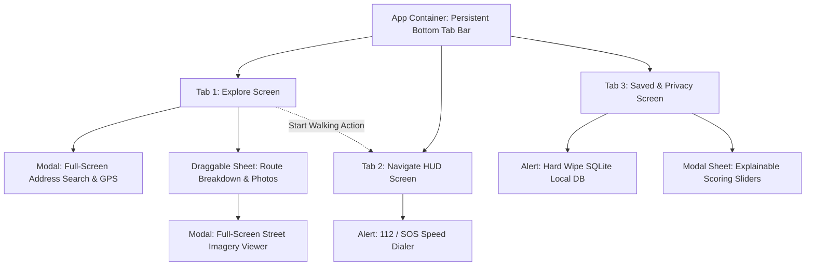

# Walkscope Native Mobile Design System (DESIGN.md)
*Standard: Google Stitch Semantic Design Specification & UI/UX Pro Max Native Ergonomics*
*Stack: React Native 0.88 / Expo 58 / TypeScript / MapLibre Native*

---

## 1. Visual Atmosphere & Aesthetic Philosophy

Walkscope is a privacy-first pedestrian route context companion. Its design ethos reflects precision cartography, astronomical daylight calculations, and explainable route-context information.
- **Aesthetic Direction:** Spatial Cartographic Dark Mode (Optimized for OLED outdoor visibility).
- **Density:** Balanced Mobile Utility (Density 5/10). No cramped desktop-like sidebars; ample breathing room with thumb-reachable interactive nodes.
- **Atmosphere:** Deep Space Obsidian (`#090D16`) with Luminescent Neon Vector Paths (`#38BDF8`), Primary Electric Blue (`#0284C7`), Amber Context (`#F59E0B`), and Slate Cards (`#1E293B`).
- **Product Honesty Constraints:**
  - OpenStreetMap features are open community data, never labeled as "verified facilities". Always label as `Mapped amenities (unverified)`.
  - Zero false security claims: The app measures mapped data density and astronomical solar position; it never guarantees personal safety or produces safety ratings.
  - Transparent storage disclosure: "Your journey history stays on this device. Route, context and map tile requests are fetched from open data providers."
- **AI Slop Elimination:** Zero generic purple drop-shadows, zero desktop scrollbars, zero unpadded touch targets, zero hover-dependent tooltips.

---

## 2. Standard Viewports & Ergonomic Thumb Zones

Designed strictly against native mobile hardware frames:
- **Android Reference Viewport:** `412 × 915 dp` (Google Pixel / Samsung Galaxy standard).
- **iOS Reference Viewport:** `390 × 844 pt` (iPhone 14/15/16 standard).
- **Safe Area Clearances:**
  - **Top Inset:** `StatusBar.currentHeight` (Android: 24–44dp) / Notch & Dynamic Island (iOS: 44–59pt).
  - **Bottom Inset:** Navigation gesture pill (Android: 16–28dp / iOS: 34pt).
  - **Horizontal Margins:** `16dp` standard gutter, `20dp` card padding.

### Thumb-Zone Ergonomic Mapping
```
+-----------------------------------+  [0% - 15%]
|  Top Inset (Status / Clocks)      |  Extreme Reach (Display-only HUD)
|  Floating Search / Route Bar      |
+-----------------------------------+  [15% - 60%]
|                                   |  Neutral Reach
|  Interactive MapLibre Canvas      |  Pinch, Zoom, Pan
|  (Edge-to-Edge Spatial Layer)     |  Floating Quick-Actions (Right Margin)
|                                   |
+-----------------------------------+  [60% - 88%]
|  Collapsible Native Bottom Sheet  |  Natural Thumb Comfort Zone
|  (Route Cards / Scores / Photos)  |  Single-hand interactive controls
+-----------------------------------+  [88% - 100%]
|  Persistent Bottom Tab Bar        |  Instant Thumb Navigation
+-----------------------------------+  (Explore | Navigate | Saved | Settings)
```

---

## 3. Mobile Touch Targets & Interaction Physics

### Strict Touch Target Enforcement
- **Android:** $\ge 48 \times 48\text{ dp}$ minimum bounding box for all pressable elements.
- **iOS:** $\ge 44 \times 44\text{ pt}$ minimum touch target.
- **Compact Icon Buttons:** Enforce minimum `48dp` container with `hitSlop={{ top: 8, bottom: 8, left: 8, right: 8 }}`.
- **Inter-Element Spacing:** Minimum `8dp` clear margin between adjacent clickable targets to eliminate mis-taps.

### Tactile Feedback & Spring Physics
- **Press States:** Native active scale-down (`transform: [{ scale: 0.96 }]`) with `80ms–120ms` ease-out spring recovery.
- **Active Opacity:** `0.75` for secondary elements; full spring bounce for primary CTA pills.
- **Gesture Arbitration:**
  - Vertical bottom sheet drags use dedicated handle drag zones (`40 × 4dp` pill) with clamped snap points (`Peek: 72dp`, `Mid: 360dp`, `Full: 85%`).
  - Horizontal route comparison uses `FlatList` with `pagingEnabled={false}` and snap intervals to avoid triggering system swipe-to-back gestures.

---

## 4. Semantic Color Tokens (OLED High Contrast)

All foreground/background text combinations guarantee **$\ge 4.5:1$ contrast ratio** (WCAG AA) and **$\ge 7:1$** for navigation cues:

| Token Name | Hex Code | Functional Role | Contrast Ratio |
| :--- | :--- | :--- | :--- |
| `background.base` | `#090D16` | Root screen canvas (True Dark OLED) | Baseline |
| `background.surface` | `#131C2E` | Floating headers, bottom sheets | 1.3:1 vs base |
| `background.card` | `#1E293B` | Route cards, dialog containers | 2.1:1 vs base |
| `border.subtle` | `rgba(255,255,255,0.08)` | Structural dividers, card borders | N/A |
| `border.focus` | `#38BDF8` | Active input & selected route highlight | 5.8:1 vs base |
| `accent.primary` | `#0284C7` | Primary action buttons ("Start Walking") | 4.8:1 vs text |
| `accent.sky` | `#38BDF8` | Active route geometry, daylight indicator | 10.2:1 vs base |
| `accent.emerald` | `#10B981` | Safe lighting, open amenities, high score | 8.4:1 vs base |
| `accent.amber` | `#F59E0B` | Twilight status, transit connections | 9.1:1 vs base |
| `accent.rose` | `#EF4444` | Emergency dialer, wipe alerts, errors | 4.9:1 vs text |
| `text.primary` | `#F8FAFC` | Main headings, maneuvers, primary values | 16.8:1 vs base |
| `text.secondary` | `#94A3B8` | Subtitles, distances, timestamps | 7.6:1 vs base |
| `text.muted` | `#64748B` | Footers, coordinate metadata | 4.6:1 vs base |

---

## 5. Typography Scale

Clean geometric sans-serif stack (`System default` / `SF Pro` on iOS, `Roboto` on Android) with tabular figures for geospatial numbers:
- **Display 1 (Large Navigation HUD):** `28pt / Bold (700) / Tracking -0.5px` — Turn maneuvers & immediate distance.
- **Title 1 (Screen / Sheet Headers):** `20pt / SemiBold (600)` — "Explore Walking Corridors".
- **Headline (Card Titles):** `16pt / SemiBold (600)` — Route alternative names, origin/destination.
- **Body Large (Step Instructions):** `15pt / Regular (400) / Leading 22pt` — Navigation steps.
- **Body (Standard Content):** `14pt / Regular (400) / Leading 20pt` — Context descriptions.
- **Footnote / Monospace (Data & Metrics):** `12pt / Medium (500) / Tabular Numbers` — Distance (`1.4 km`), Duration (`18 min`), Coordinates.

---

## 6. Native Navigation Hierarchy & Screen Flow

The application is structured into **3 Primary Bottom Tabs** + **1 Modal HUD Flow**:



### Tab 1: Explore (`ExploreScreen.tsx`)
- **Full-Screen Map:** MapLibre fills 100% of the screen.
- **Floating Top Pill:** Shows current Start & Destination. Tapping opens search modal.
- **Floating Controls (Right Edge):** Recenter GPS, toggle Camera Photos, toggle Amenities.
- **Interactive Bottom Sheet:**
  - Snap 1 (Collapsed): Active Route summary (`1.2 km`, `15 min`, `84% Context`), primary "Start Walking" button.
  - Snap 2 (Mid): Horizontal route alternatives cards with context comparison.
  - Snap 3 (Expanded): Panoramax street-level photo strip, daylight angle badge, full breakdown.

### Tab 2: Navigate (`NavigateScreen.tsx`)
- **Live Walking Companion:** Distraction-free HUD for when user is actively moving on foot.
- **High-Contrast Maneuver Card:** Giant directional arrow (`turn-left`, `turn-right`, `straight`), upcoming street name, meters remaining.
- **Solar & Lighting Status:** Real-time sun angle and street lighting verification for current road.
- **Persistent SOS Emergency Button:** Prominently anchored at bottom right for immediate 1-tap call.

### Tab 3: Saved & Privacy (`SavedJourneysScreen.tsx`)
- **Saved Corridors:** Fast FlatList of pinned journeys with offline status indicators.
- **Zero Cloud Guarantee Card:** Explains on-device SQLite storage, zero analytics, zero server-side telemetry.
- **Scoring Preferences:** Interactive weight sliders for street lights, open businesses, emergency police/fire, road type.
- **Hard Wipe Button:** 1-tap cryptographic zeroing of all stored routes and cached vector tiles.

---

## 7. Component Primitives (21st.dev & Native Expo Standards)

1. **`BottomTabBar`**: 48dp touch targets, active icon tint `#38BDF8`, inactive `#64748B`, safe-area bottom clearance.
2. **`GlassCapsule`**: High-contrast translucent surface (`rgba(19, 28, 46, 0.92)`) with subtle blur and 1px border.
3. **`RouteCard`**: Pressable container with 120ms spring scale feedback, dual-color badges, and selected border glow.
4. **`ScoreRing`**: Circular or horizontal segment score indicator (0–100%) mapped to Emerald ($\ge 80$), Amber ($50-79$), Rose ($<50$).
5. **`ManeuverHUD`**: High-contrast icon badge with directional arrow and step instruction text.

