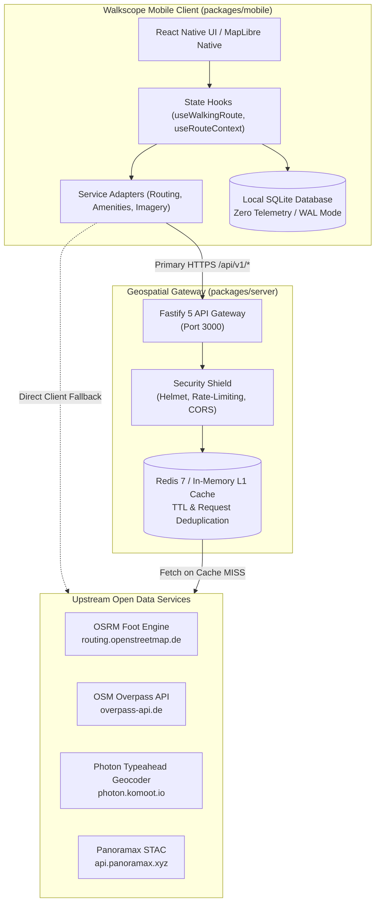
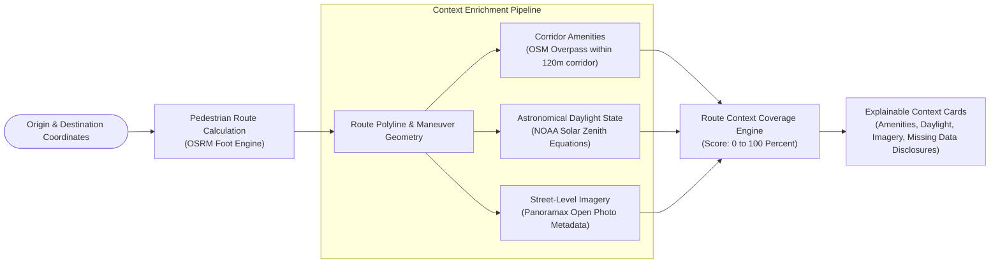
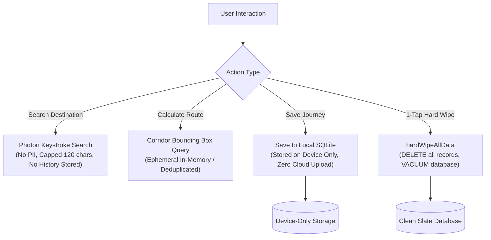

# Walkscope

> Transparent, privacy-first pedestrian walking context and route companion.

[](https://github.com/KatkamKoushik/Walkscope/actions/workflows/ci.yml)
[](https://www.typescriptlang.org/)
[](https://nodejs.org/)
[](https://fastify.dev/)
[](https://reactnative.dev/)
[](https://expo.dev/)
[](https://www.docker.com/)
[](https://nodejs.org/api/test.html)
[](LICENSE)

---

## 1. Overview

Walkscope is a mobile-first pedestrian navigation companion engineered to provide transparent, explainable contextual information along walking routes. Rather than computing opaque, subjective "safety scores", Walkscope evaluates verifiable **Route Context Coverage** (0 to 100%) by analyzing mapped physical infrastructure, astronomical daylight conditions, and open street-level imagery.

### Core Distinctions

- **Explainable Route Context, Not Subjective Safety**: Evaluates verifiable data density (mapped amenities, transit stops, lighting infrastructure, daylight position, and street photography) and explicitly discloses missing information.
- **Zero Telemetry and Local-First Privacy**: No analytics SDKs, advertising trackers, or external coordinate logging. Journey history and saved locations remain exclusively in an on-device SQLite database with a single-tap hard wipe.
- **Fair-Use Protected Network Architecture**: Pedestrian routing, corridor amenities, and autocomplete requests are shielded by a dedicated Fastify gateway that provides request deduplication, rate limiting, and multi-tier caching (Redis L1 / PostGIS L2).
- **Graceful Client Degradation**: The mobile application operates cleanly when connected to the gateway server or falls back to direct client-side open APIs for standalone operation.

---

## 2. System Architecture

Walkscope is architected as an npm workspace monorepo adhering to clean architecture and ports-and-adapters principles.



---

## 3. Route Context Coverage Pipeline

The scoring engine translates raw physical infrastructure and astronomical solar math into an explainable metric from 0% to 100%, accompanied by mandatory honesty disclaimers.



### Context Breakdown

| Component | Metric Weight | Measurement Criteria | Disclosed Limitations |
| :--- | :--- | :--- | :--- |
| **Mapped Amenities** | 0 to 40 Points | Density of mapped transit, emergency, services, and lighting within a 120-meter corridor around the route polyline. | Tagged as `mapped_unverified`; does not confirm whether facilities are operational, open, or staffed now. |
| **Solar Daylight** | 0 to 30 Points | Astronomical solar elevation angle calculated via standard NOAA solar position equations. | Estimates natural solar illumination only; does not measure physical streetlights, canopy, or weather conditions. |
| **Street Imagery** | 0 to 30 Points | Verified coverage from open street-level imagery providers (Panoramax / Mapillary) with capture timestamps. | Surfaces capture date and 360-degree vs. flat perspective; absence of imagery is marked as missing data. |

---

## 4. Privacy & Zero-Knowledge Data Lifecycle



---

## 5. Monorepo Structure

```text
walkscope/
├── packages/
│   ├── core/                          # Pure domain models, mathematical formulas, and offline adapters
│   │   ├── domain/                    # Type-safe schemas (route, context-feature, imagery, scoring)
│   │   ├── providers/
│   │   │   ├── amenities/             # Overpass client with strict polyline distance filtering
│   │   │   ├── routing/               # Client routing service, OSRM parsers, deterministic hash IDs
│   │   │   └── imagery/               # Panoramax STAC client and vector tile trimming utilities
│   │   └── services/
│   │       ├── contextScoringService.js # Route Context Coverage evaluation algorithm
│   │       └── twilightService.js     # NOAA solar zenith and daylight calculation functions
│   │
│   ├── mobile/                        # React Native 0.76+ and Expo 52 Android application
│   │   ├── android/                   # Native Android project with security configs & ProGuard rules
│   │   ├── src/
│   │   │   ├── components/            # Modular presentation components (Cards, Modals, ActionBars)
│   │   │   ├── hooks/                 # Decoupled state hooks (useWalkingRoute, useRouteContext)
│   │   │   └── services/              # Client adapters (routingAdapter, amenityAdapter, storageService)
│   │   └── App.tsx                    # Clean orchestrator root
│   │
│   └── server/                        # Geospatial Gateway backend
│       ├── src/
│       │   ├── cache/                 # Multi-tier caching (MemoryCacheService with auto-sweep + Redis)
│       │   ├── routes/                # REST endpoints for routing, context, imagery, and geocoding
│       │   ├── server.ts              # Fastify 5 server factory with Helmet and rate limiting
│       │   └── index.ts               # Server entry point
│       └── Dockerfile                 # Multi-stage production container build
│
├── .github/workflows/ci.yml           # Automated quality gate (Lint, TruffleHog, Typecheck, Doctor, Tests)
├── docker-compose.yml                 # Local and production infrastructure (Gateway, Redis 7, PostGIS 16)
└── package.json                       # Monorepo root workspace configuration
```

---

## 6. Verification and Quality Gates

The project maintains a zero-tolerance policy for type errors, lint warnings, test regressions, and dependency vulnerabilities.

| Check | Tool / Framework | Target Scope | Command | Current Status |
| :--- | :--- | :--- | :--- | :--- |
| **Static Types** | TypeScript 5.3+ | `core`, `mobile`, `server` | `npm run typecheck` | **0 Errors** |
| **Code Quality** | ESLint | `core`, `server` | `npm run lint` | **0 Errors** |
| **Mobile Health** | Expo Doctor | `mobile` | `cd packages/mobile && npx expo-doctor` | **20/20 Passed** |
| **Unit Tests** | Node.js Test Runner | All packages | `npm test` | **167/167 Passed** |
| **Android Build** | Gradle Wrapper | Native Android app | `cd packages/mobile/android && ./gradlew tasks` | **Verified** |
| **Secret Scan** | TruffleHog v3.88.5 | Entire repository | Handled in CI workflow | **Verified Clean** |

---

## 7. Quick Start Guide

### Prerequisites

- Node.js 20 LTS or higher
- npm 10 or higher
- Android SDK 34+ (for local Android builds) or Expo Go / Dev Client

### Step 1: Install Dependencies & Verify Build

```bash
# Clone the repository
git clone https://github.com/KatkamKoushik/Walkscope.git
cd Walkscope

# Install monorepo dependencies deterministically
npm ci

# Run static typecheck across all packages
npm run typecheck

# Execute the complete offline unit test suite
npm test
```

### Step 2: Run the Geospatial Gateway Server

You can run the gateway directly with Node.js or via Docker Compose.

#### Option A: Direct Node.js Execution
```bash
# Build the TypeScript server
npm run build:server

# Start the gateway on port 3000
npm run start:server
```

#### Option B: Docker Compose (Gateway + Redis 7 + PostGIS 16)
```bash
docker compose up -d
```

Verify that the gateway is operational:
```bash
curl http://localhost:3000/health
```

Expected response:
```json
{
  "status": "ok",
  "service": "Walkscope Geospatial Gateway",
  "version": "1.0.0",
  "uptime": 12,
  "cacheEntries": 0,
  "timestamp": "2026-10-31T03:00:00.000Z"
}
```

### Step 3: Run the Mobile Application

```bash
# Navigate to the mobile package
cd packages/mobile

# Start Expo dev server
npx expo start

# For connected Android physical device or emulator (with adb reverse)
adb reverse tcp:3000 tcp:3000
npm run android
```

---

## 8. Gateway API Reference

All gateway routes reside under `/api/v1` and feature fair-use rate limiting (100 req/min per IP) and HTTP cache status indicators (`X-Cache-Status: HIT | MISS`).

### 1. Pedestrian Routing
- **Method**: `POST`
- **Path**: `/api/v1/routes/pedestrian`
- **Request Body**:
  ```json
  {
    "origin": { "latitude": 51.5080, "longitude": -0.1281 },
    "destination": { "latitude": 51.5120, "longitude": -0.1240 },
    "timeoutMs": 12000
  }
  ```
- **Response**: Parsed route options, normalized turn maneuvers, distance formatting, and deterministic FNV-1a route signatures.

### 2. Corridor Context & Amenities
- **Method**: `POST`
- **Path**: `/api/v1/context/corridor`
- **Request Body**:
  ```json
  {
    "coordinates": [[-0.1281, 51.5080], [-0.1240, 51.5120]],
    "maxCorridorDistanceMeters": 120,
    "bufferDegrees": 0.0015
  }
  ```
- **Response**: Mapped features filtered strictly by polyline proximity, breakdown by category (transit, emergency, services, lighting), and standard ODbL disclaimers.

### 3. Autocomplete & Geocoding
- **Method**: `GET`
- **Path**: `/api/v1/geocode/search?q=Covent%20Garden&limit=5`
- **Response**: Structured list of matching places with geographic coordinates and formatted address subtitles.

### 4. Vector Tile Trimmer
- **Method**: `GET`
- **Path**: `/api/v1/imagery/tiles/:z/:x/:y`
- **Response**: Optimized, layer-pruned Protocol Buffer vector tile with non-essential layers dropped.

---

## 9. Security & Privacy Architecture

- **No Cleartext External Leaks**: Enforces strict `network_security_config.xml` on Android permitting cleartext traffic solely to loopback dev addresses (`127.0.0.1`, `localhost`). All remote traffic requires HTTPS.
- **Backup Disabled**: `android:allowBackup="false"` in the application manifest blocks extraction of private SQLite tables via `adb backup`.
- **System Dialing Intent**: Explicit declaration of the `tel:` dialer scheme in Android package visibility rules allows rapid invocation of emergency numbers (such as 112) without granting third-party network access.
- **R8 / ProGuard Keep Rules**: Specific rules protect MapLibre GL Native and Expo SQLite JNI bridges from being stripped during release compilation.
- **Strict Content Security**: Fastify gateway uses `@fastify/helmet` to set strict HTTP headers including `nosniff` and `DENY` framing policies.

---

## 10. Attribution & Open Data Licenses

Walkscope is powered by open data communities. All upstream licenses and attribution requirements are strictly preserved:

- **OpenStreetMap**: Mapped data and amenities are copyright OpenStreetMap contributors and licensed under the Open Database License (ODbL).
- **Cartography**: Basemap tiles provided by CARTO Voyager under Creative Commons licenses.
- **Street Photography**: Photos retrieved via Panoramax are copyright their respective contributors and licensed under Creative Commons Attribution-ShareAlike 4.0 International (CC-BY-SA 4.0).
- **Solar Position Models**: Daylight equations derived from National Oceanic and Atmospheric Administration (NOAA) solar position formulas.
- **Map Rendering**: Native vector tile rendering provided by the MapLibre GL Native ecosystem.

---

## 11. License

This project is licensed under the [MIT License](LICENSE).
