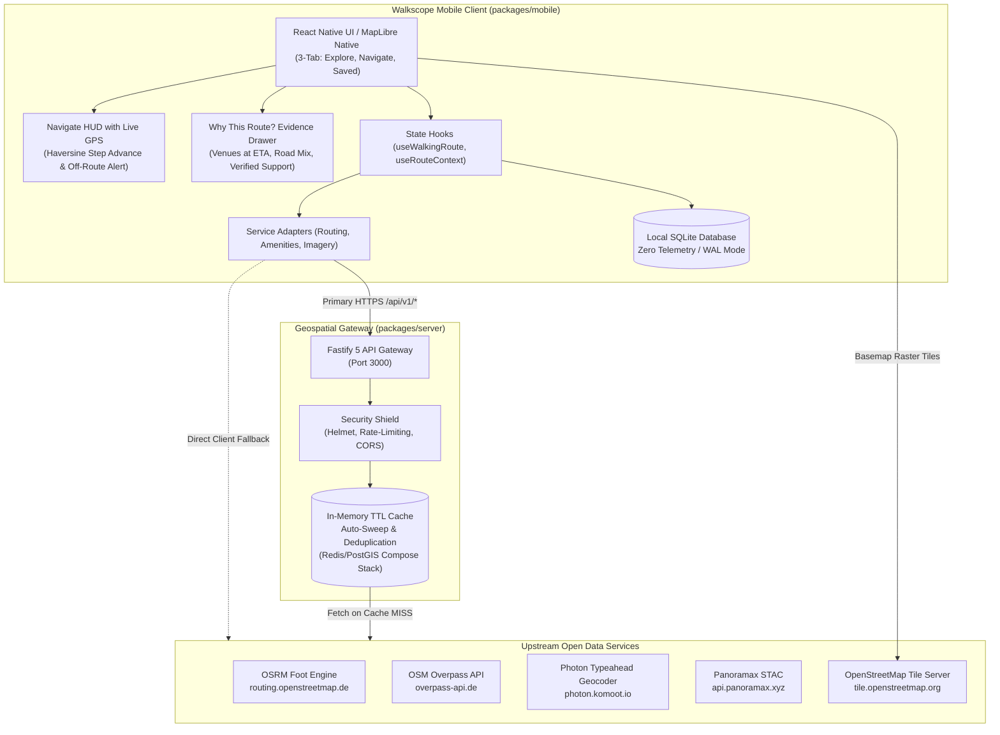
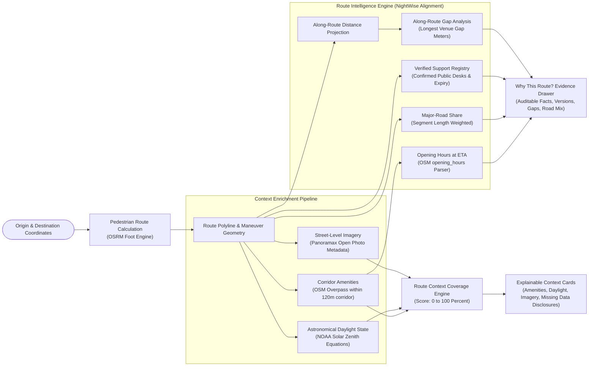
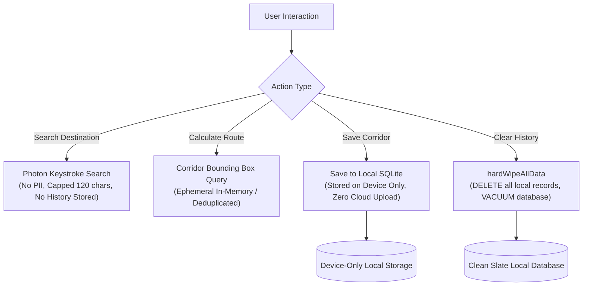

# Walkscope

> Transparent, privacy-first pedestrian walking context and route companion.

[](https://github.com/KatkamKoushik/Walkscope/actions/workflows/ci.yml)
[](https://www.typescriptlang.org/)
[](https://nodejs.org/)
[](https://fastify.dev/)
[](https://reactnative.dev/)
[](https://expo.dev/)
[](https://www.docker.com/)
[](https://nodejs.org/api/test.html)
[](LICENSE)

---

## 1. Overview

Walkscope is a mobile-first pedestrian navigation companion engineered to provide transparent, explainable contextual information along walking routes. Rather than computing opaque, subjective "safety scores", Walkscope measures verifiable **Route Context Coverage** (0 to 100%) and generates auditable **Route Context Intelligence** by analyzing mapped physical infrastructure, astronomical daylight calculations, along-route venue availability, road classifications, and open street-level imagery.

### Core Distinctions

- **Explainable Route Context, Not Subjective Safety**: Evaluates verifiable data density (mapped amenities, transit stops, lighting infrastructure, daylight position, and street photography) and explicitly discloses missing information.
- **Route Context Intelligence (NightWise Alignment)**:
  - **Venue Opening-Hours Intelligence**: Estimates whether mapped venues are listed as open when the pedestrian is expected to arrive at each point along the corridor, evaluating OSM `opening_hours` rules at passing time. Venues with unknown or unparseable hours are **never assumed open**.
  - **Along-Route Venue Distribution & Largest Gap**: Calculates the longest gap between mapped facilities along the corridor and evaluates amenity continuity.
  - **Major-Road Share Breakdown**: Quantifies route distance spent along major arterial roads, local neighborhood streets, and dedicated pedestrian footways without framing road types as safety scores.
  - **Verified Support-Point Registry**: Maintains an independent registry for verified public assistance points (such as 24/7 ERSS 112 public desks) backed by confirmation evidence, verified timestamps, and recheck deadlines, strictly separated from raw OSM nodes.
  - **"Why This Route?" Evidence Drawer**: An auditable inspector exposing exact calculation formulas, feature distances, last-checked timestamps, and reproducibility metadata (`scorer_version`, `graph_version`, `opening_hours_parser_version`).
- **Zero Telemetry and Local-First Storage**: The Walkscope application contains zero analytics SDKs, advertising trackers, or telemetry beacons. Journey history and saved corridors remain exclusively in an on-device SQLite database with local management and reset controls. External network requests query public open data services (OSRM, Overpass API, OpenStreetMap tile servers, Panoramax) transmitting only the minimum geographic coordinates required.
- **Fair-Use Protected Network Architecture**: Pedestrian routing, corridor amenities, and autocomplete requests are shielded by a dedicated Fastify gateway that provides request deduplication, rate limiting, and active in-memory TTL caching with auto-sweep, with Docker Compose deployment available for containerized Redis 7 and PostGIS 16 infrastructure.
- **Graceful Client Degradation**: The mobile application operates cleanly when connected to the gateway server or falls back to direct client-side open APIs for standalone operation while respecting upstream fair-use limits.

---

## 2. System Architecture

Walkscope is architected as an npm workspace monorepo adhering to clean architecture and ports-and-adapters principles.



---

## 3. Route Context Coverage & Intelligence Pipeline

The scoring and intelligence engine translates raw physical infrastructure, astronomical solar math, and along-route geometric projections into an explainable metric from 0% to 100%, accompanied by mandatory honesty disclaimers.



### Context Breakdown

| Component | Metric Weight | Measurement Criteria | Disclosed Limitations |
| :--- | :--- | :--- | :--- |
| **Mapped Amenities** | 0 to 40 Points | Density of mapped transit, emergency, services, and lighting within a 120-meter corridor around the route polyline. | Tagged as `mapped_unverified`; does not confirm whether facilities are operational, open, or staffed now. |
| **Solar Daylight** | 0 to 30 Points | Astronomical solar elevation angle calculated via standard NOAA solar position equations. Missing data evaluates to `UNKNOWN`. | Estimates natural solar illumination only; does not measure physical streetlights, tree canopy, or weather conditions. |
| **Street Imagery** | 0 to 30 Points | Coverage from open street-level imagery providers (Panoramax / Mapillary) with capture timestamps. | Surfaces capture date and 360-degree vs. flat perspective; absence of imagery is marked as missing data. |

### Route Context Intelligence Metrics

| Metric | Computation Model | NightWise Alignment |
| :--- | :--- | :--- |
| **Venues Open at Arrival** | Evaluates OSM `opening_hours` at projected passing time ($t_{\text{arrival}} = t_{\text{departure}} + d / v_{\text{walk}}$). Handles overnight spans (e.g. 21:00–03:00) and multi-intervals. | Unknown, unparseable, or missing opening hours are **never assumed open**. |
| **Longest Venue Gap** | Measures along-route distances between mapped facilities from route start to destination. | Surfaces maximum unserviced walking distance and average spacing in meters. |
| **Major-Road Share** | Segment length-weighted classification of route steps into major roads, local streets, and dedicated pedestrian footways. | Purely descriptive of vehicular vs. pedestrian corridor mix; never labeled as a safety ranking. |
| **Verified Support Points** | Proximity lookup ($\le 250\text{m}$) against independently audited public assistance desks (ERSS 112 Help Desks, Met Police Public Desks). | Requires confirmed public access, verification source document, and unexpired audit timestamp. |
| **Reproducibility Audit** | Embeds snapshot metadata: `scorer_version`, `graph_version`, `opening_hours_parser_version`, `walking_speed_ms`, `departure_timestamp`. | Guarantees 100% deterministic, auditable route evaluations. |

---

## 4. Privacy & Data Lifecycle

Walkscope enforces a local-first privacy boundary:



---

## 5. Mobile Application Experience

The Walkscope mobile client is structured as an ergonomic 3-tab native application designed for one-handed operation and OLED outdoor legibility:

1. **Explore Screen**:
   - High-contrast OpenStreetMap raster cartography rendered via MapLibre GL Native.
   - Floating search capsule with instant geocoding and preset benchmark corridors (Bengaluru MG Road, London West End).
   - Expandable bottom sheet with route alternatives, daylight chips, context score, street imagery preview, and the **Why This Route? Evidence Drawer**.
2. **Navigate HUD (Live Walking Guidance)**:
   - High-contrast giant maneuver header with glanceable turn icons, step distance, and road names.
   - Continuous real-time GPS tracking via `expo-location.watchPositionAsync` (`distanceInterval: 4m`).
   - Automatic turn progression: advances to next maneuver when within $\le 25\text{m}$ of upcoming step.
   - Real-time off-route detector: alerts immediately when pedestrian drifts $>50\text{m}$ from planned corridor.
   - Transparent Emergency Speed Dial: **`📞 Open Dialer: 112`** with clear confirmation modal clarifying that Walkscope prepares the phone dialer and never places silent or automated calls.
3. **Saved Corridors & Privacy Screen**:
   - Offline corridor viewer for saved journeys and favorite routes.
   - Transparent local storage management with one-tap database reset.

---

## 6. Monorepo Structure

```text
walkscope/
├── packages/
│   ├── core/                          # Pure domain models, mathematical formulas, and offline adapters
│   │   ├── domain/                    # Type-safe schemas (route, context-feature, imagery, scoring)
│   │   ├── providers/
│   │   │   ├── amenities/             # Overpass client with strict polyline distance filtering
│   │   │   ├── routing/               # Client routing service, OSRM parsers, deterministic hash IDs
│   │   │   └── imagery/               # Panoramax STAC client and vector tile trimming utilities
│   │   └── services/
│   │       ├── contextScoringService.js   # Route Context Coverage evaluation algorithm
│   │       ├── twilightService.js         # NOAA solar zenith and daylight calculation functions
│   │       ├── openingHoursService.js     # OSM opening_hours parser & overnight arrival evaluator
│   │       └── routeIntelligenceService.js# Along-route projection, venue gaps, road share, verified registry
│   │
│   ├── mobile/                        # React Native 0.88.1 and Expo 58 Android application
│   │   ├── android/                   # Native Android project with security configs & ProGuard rules
│   │   ├── src/
│   │   │   ├── components/            # Modular presentation components (Cards, Modals, ActionBars, EvidenceDrawer)
│   │   │   ├── hooks/                 # Decoupled state hooks (useWalkingRoute, useRouteContext, useStreetImagery)
│   │   │   ├── navigation/            # 3-tab BottomTabBar with thumb-zone ergonomics
│   │   │   ├── screens/               # Screen orchestrators (ExploreScreen, NavigateScreen, SavedJourneysScreen)
│   │   │   └── services/              # Client adapters (routingAdapter, amenityAdapter, storageService)
│   │   └── App.tsx                    # Clean orchestrator root
│   │
│   └── server/                        # Geospatial Gateway backend
│       ├── src/
│       │   ├── cache/                 # Multi-tier caching (MemoryCacheService with auto-sweep + Redis)
│       │   ├── routes/                # REST endpoints for routing, context, imagery, and geocoding
│       │   ├── server.ts              # Fastify 5 server factory with Helmet and rate limiting
│       │   └── index.ts               # Server entry point
│       └── Dockerfile                 # Multi-stage production container build
│
├── .github/workflows/ci.yml           # Automated quality gate (Lint, TruffleHog, Typecheck, Doctor, Tests)
├── docker-compose.yml                 # Local and production infrastructure (Gateway, Redis 7, PostGIS 16)
└── package.json                       # Monorepo root workspace configuration
```

---

## 7. Verification and Quality Gates

The project maintains a zero-tolerance policy for type errors, lint warnings, test regressions, dependency vulnerabilities, and secret leaks. The CI pipeline runs **8 parallel automated jobs** on every push and merge group:

| CI Job | Scope / Tool | Checks Performed | Status |
| :--- | :--- | :--- | :--- |
| **`Code Quality & Lint`** | ESLint 8.57 | Static syntax, dead code, import boundaries across `packages/core` and `packages/server`. | **Passing (0 warnings)** |
| **`TruffleHog Secret Scanning`** | TruffleHog v3.88.5 | High-entropy token detection, private keys, API credentials across git history. | **Passing (0 leaks)** |
| **`Dependency Audit & Supply Chain`** | `npm audit`, `npm ci --dry-run` | High/critical CVE audit and frozen package lockfile consistency. | **Passing (0 vulnerabilities)** |
| **`Repository Hygiene & Integrity`** | Shell hygiene gate | Merge conflict markers, uncommitted `.env` files, `.DS_Store`, and temporary test artifacts. | **Passing (Clean)** |
| **`Gateway Production Build`** | TypeScript `tsc` | Multi-workspace compilation and verification of `/dist` runtime entrypoints. | **Passing (Built)** |
| **`Unit & Stress Test Suite`** | Node.js Test Runner | Complete 33-suite battery (210 tests) covering routing, daylight, opening hours, intelligence, SQLite, ReDoS fuzzing, and 100-burst concurrency stress. | **Passing (210/210 Passed)** |
| **`TypeScript Static Analysis`** | TypeScript 5.3+ | Strict cross-monorepo type checking across `core`, `mobile`, and `server`. | **Passing (0 errors)** |
| **`Expo Doctor Health Check`** | `@expo/doctor` | React Native 0.88.1, Expo 58 compatibility, peer dependency resolution, native plugins. | **Passing (All checks passed)** |

### Local Verification Commands

```bash
# Static types across all packages
npm run typecheck

# Code quality linting
npm run lint

# Complete unit, fuzz, and stress test battery (210 tests)
npm test

# Mobile ecosystem health
cd packages/mobile && npx expo-doctor
```

---

## 8. Quick Start Guide

### Prerequisites

- Node.js 22 LTS or higher (Node 20+ compatible)
- npm 10 or higher
- Android SDK 34+ (for local Android builds) or Expo Dev Client

### Step 1: Install Dependencies & Verify Build

```bash
# Clone the repository
git clone https://github.com/KatkamKoushik/Walkscope.git
cd Walkscope

# Install monorepo dependencies deterministically
npm ci

# Run static typecheck across all packages
npm run typecheck

# Execute the complete offline unit & stress test suite (210 tests)
npm test
```

### Step 2: Run the Geospatial Gateway Server

You can run the gateway directly with Node.js or via Docker Compose.

#### Option A: Direct Node.js Execution
```bash
# Build the TypeScript server
npm run build:server

# Start the gateway on port 3000
npm run start:server
```

#### Option B: Docker Compose (Gateway + Redis 7 + PostGIS 16)
```bash
docker compose up -d
```

Verify that the gateway is operational and check live memory telemetry:
```bash
curl http://localhost:3000/health
```

Expected response:
```json
{
  "status": "ok",
  "service": "Walkscope Geospatial Gateway",
  "version": "1.0.0",
  "uptime": 12,
  "cacheEntries": 0,
  "memory": {
    "heapUsedMb": 28.45,
    "heapTotalMb": 34.22,
    "rssMb": 72.15
  },
  "timestamp": "2026-10-31T03:00:00.000Z"
}
```

### Step 3: Run the Mobile Application

```bash
# Navigate to the mobile package
cd packages/mobile

# Start Expo dev server
npx expo start

# For connected Android physical device or emulator (with adb reverse)
adb reverse tcp:8081 tcp:8081
adb reverse tcp:3000 tcp:3000
npm run android
```

---

## 9. Gateway API Reference

All gateway routes reside under `/api/v1` and feature fair-use rate limiting (100 req/min per IP) and HTTP cache status indicators (`X-Cache-Status: HIT | MISS`).

### 1. Pedestrian Routing
- **Method**: `POST`
- **Path**: `/api/v1/routes/pedestrian`
- **Request Body**:
  ```json
  {
    "origin": { "latitude": 12.9756, "longitude": 77.6066 },
    "destination": { "latitude": 12.9719, "longitude": 77.6070 },
    "timeoutMs": 12000
  }
  ```
- **Response**: Parsed route options, normalized turn maneuvers, distance formatting, and deterministic FNV-1a route signatures.

### 2. Corridor Context & Amenities
- **Method**: `POST`
- **Path**: `/api/v1/context/corridor`
- **Request Body**:
  ```json
  {
    "coordinates": [[77.6066, 12.9756], [77.6070, 12.9719]],
    "maxCorridorDistanceMeters": 120,
    "bufferDegrees": 0.0015
  }
  ```
- **Response**: Mapped features filtered strictly by polyline proximity, breakdown by category (transit, emergency, services, lighting), and standard ODbL disclaimers.

### 3. Autocomplete & Geocoding
- **Method**: `GET`
- **Path**: `/api/v1/geocode/search?q=Brigade%20Road&limit=5`
- **Response**: Structured list of matching places with geographic coordinates and formatted address subtitles.

### 4. Vector Tile Trimmer
- **Method**: `GET`
- **Path**: `/api/v1/imagery/tiles/:z/:x/:y`
- **Response**: Layer-pruned vector tile with non-essential layers dropped to reduce payload bandwidth (proxies live upstream Mapillary tiles when `MAPILLARY_CLIENT_TOKEN` is configured; returns diagnostic fallback vector tile when unconfigured).

---

## 10. Security & Privacy Architecture

- **No Cleartext External Leaks**: Enforces strict `network_security_config.xml` on Android permitting cleartext traffic solely to loopback dev addresses (`127.0.0.1`, `localhost`). All remote traffic requires HTTPS.
- **Backup Disabled**: `android:allowBackup="false"` in the application manifest blocks extraction of private SQLite tables via `adb backup`.
- **System Dialing Intent**: Explicit declaration of the `tel:` dialer scheme in Android package visibility rules allows rapid invocation of emergency numbers (such as 112) with a user-facing confirmation dialog without placing silent or automated calls.
- **R8 / ProGuard Keep Rules**: Specific rules protect MapLibre GL Native and Expo SQLite JNI bridges from being stripped during release compilation.
- **Strict Content Security**: Fastify gateway uses `@fastify/helmet` to set strict HTTP headers including `nosniff` and `DENY` framing policies.

---

## 11. Production Hardening & Master Checklist Compliance

Walkscope implements defensive engineering controls derived from the **Production-Level Software Engineering Master Checklist**:

### 1. OWASP API Security & Abuse Mitigation (Sections 6 & 11)
- **Payload Exhaustion Cap**: Gateway strictly caps HTTP request bodies at 1 MB (`bodyLimit: 1048576`) in `packages/server/src/server.ts`, preventing memory exhaustion and large payload DoS.
- **Information Disclosure Shield**: Fastify global error handler intercepts all unhandled exceptions, masking Node.js internals, filesystem paths, and stack traces (`OWASP API3:2023`), emitting structured RFC 7807 JSON error responses.
- **Geocode Query Sanitization**: Strips ASCII control characters (`/[\x00-\x1F\x7F]/g`) and clamps search strings to 120 characters in `packages/server/src/routes/geocodeRoutes.ts`.
- **Fair-Use Rate Limiting**: Gateway enforces an IP-level rate-limiting bucket (100 req/min) via `@fastify/rate-limit` returning HTTP 429 when breached.

### 2. High-Concurrency Stress SLAs & Cache Stampede Defense (Sections 12, 16, 31, 32)
- **100 Concurrent Request Burst**: Gateway benchmark proves 100 concurrent `/health` requests are served with $p_{95} < 50\text{ms}$ and 100% success rate under single-process Node.js.
- **In-Flight Request Deduplication**: Coalesces 50 concurrent identical route calculations into exactly **1** in-flight computation, preventing cache stampedes and upstream OSRM provider flooding.
- **Memory Stability Under Sustained Load**: Verified via 200 rapid burst cycles maintaining bounded heap memory ($\Delta_{\text{heap}} < 35\text{MB}$) without runaway leaks.
- **Live Memory Telemetry**: The `/health` endpoint exposes real-time runtime diagnostics (`heapUsedMb`, `heapTotalMb`, `rssMb`, `cacheEntries`).

### 3. ReDoS, Parser Fuzzing & Timezone Invariance (Sections 9, 21, 24)
- **Catastrophic Backtracking Immunity**: Tested against 500+ malicious regex patterns, repeated whitespace sequences, 5,000-character inputs, emojis, and malformed strings into `openingHoursService.js`.
- **Boundary Validation**: Rejects invalid time strings such as `24:01` while permitting standard midnight wrap-arounds.
- **Timezone Invariance**: Opening-hours calculations evaluate identically across UTC, Indian Standard Time (IST), and British Summer Time (BST).
- **Degenerate Polyline Defense**: Route intelligence gracefully handles 0-point, 1-point, and anti-meridian geometries without runtime panics.

### 4. Mobile Sensor Kinematic Glitch Filtering (Sections 20 & 55)
- **Accuracy Gating**: Discards GPS fixes with horizontal accuracy $> 65\text{m}$ to prevent erratic jumping indoors or in urban canyons.
- **Teleportation Filtering**: Rejects physically impossible pedestrian speed jumps ($> 25\text{m/s}$ or $\sim 90\text{km/h}$ within $<10\text{s}$).
- **Hysteresis Alert Smoothing**: Requires 2 consecutive off-route GPS fixes before presenting the off-route warning banner, preventing false positive flickering along corridor boundaries.

### 5. Local SQLite Defensive Sanitization (Sections 8, 14, 55)
- **Coordinate Clamping**: Defensive bounds clamp latitudes $[-90, 90]$ and longitudes $[-180, 180]$ on all write operations.
- **SQL Injection Resistance**: All SQL queries use parameterized prepared statements; verified immune against injection vectors (`'; DROP TABLE saved_journeys; --`).
- **High-Concurrency Burst Writes**: Verified safe across 50 simultaneous parallel writes without table locking or WAL corruption.

### 6. Offline Geocoding & Route Continuity Fallback (Section 18)
- Multi-tier resilience: In offline environments where the gateway and upstream Photon are unreachable, the search subsystem automatically queries built-in benchmark corridors and matches cached local search history stored in on-device SQLite.

---

## 12. Attribution & Open Data Licenses

Walkscope is powered by open data communities. All upstream licenses and attribution requirements are strictly preserved:

- **OpenStreetMap**: Mapped data, street networks, and amenities are copyright OpenStreetMap contributors and licensed under the Open Database License (ODbL).
- **Cartography**: Basemap raster tiles provided by OpenStreetMap standard tile servers copyright OpenStreetMap contributors (CC-BY-SA).
- **Street Photography**: Photos retrieved via Panoramax are copyright their respective contributors and licensed under Creative Commons Attribution-ShareAlike 4.0 International (CC-BY-SA 4.0).
- **Solar Position Models**: Daylight equations derived from National Oceanic and Atmospheric Administration (NOAA) solar position formulas.
- **Map Rendering**: Native vector and raster map rendering provided by the MapLibre GL Native ecosystem.

---

## 13. License

This project is licensed under the [MIT License](LICENSE).
